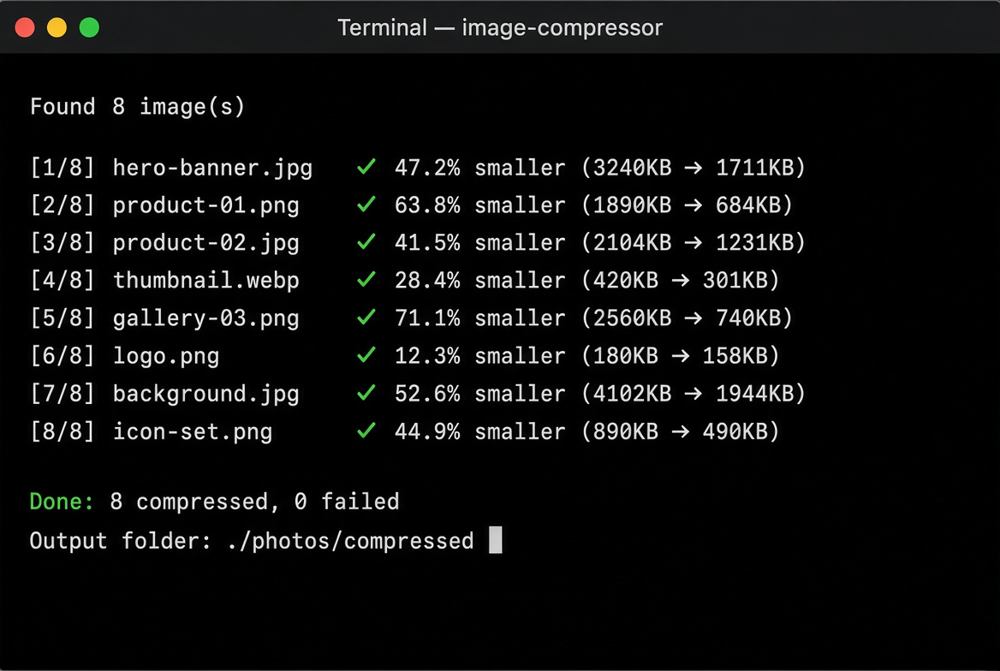

# Image Compressor

<div align="center">


یک ابزار خط فرمان ساده، سریع و کاربردی برای **فشرده‌سازی دسته‌ای تصاویر**

مناسب برای کاهش حجم عکس‌ها قبل از آپلود در وب‌سایت، فروشگاه، شبکه اجتماعی یا هر پروژه دیگری.

</div>

---

## ویژگی‌ها

- فشرده‌سازی دسته‌ای یک پوشه (با پشتیبانی از زیرپوشه‌ها)
- کنترل دقیق کیفیت (۱ تا ۱۰۰)
- تغییر اندازه هوشمند با حفظ نسبت تصویر
- تبدیل فرمت به JPEG، PNG یا WebP
- نمایش درصد کاهش حجم برای هر فایل
- حالت `--dry-run` برای پیش‌نمایش
- خروجی تمیز و رنگی در ترمینال
- بدون وابستگی اضافی (فقط Pillow)

## نصب

```bash
git clone https://github.com/YOUR_USERNAME/image-compressor.git
cd image-compressor
pip install -r requirements.txt
```

یا به صورت مستقیم:

```bash
pip install Pillow
```

## استفاده سریع

```bash
# فشرده‌سازی ساده یک پوشه
python compressor.py ./photos

# با کیفیت مشخص و پوشه خروجی
python compressor.py ./photos -q 75 -o ./optimized

# محدود کردن عرض + تبدیل به WebP
python compressor.py ./photos --max-width 1920 --convert webp -q 80
```

## مثال‌های کاربردی

### ۱. فشرده‌سازی برای وب (کیفیت ۸۰)

```bash
python compressor.py ./product-images -q 80 -o ./web-ready
```

### ۲. آماده‌سازی تصاویر اینستاگرام / شبکه‌های اجتماعی

```bash
python compressor.py ./raw-photos --max-width 1080 -q 85
```

### ۳. تبدیل دسته‌ای به WebP (کمترین حجم)

```bash
python compressor.py ./images --convert webp -q 75 -o ./webp-version
```

### ۴. پیش‌نمایش قبل از اجرا

```bash
python compressor.py ./photos --dry-run
```

### ۵. فشرده‌سازی یک فایل تکی

```bash
python compressor.py banner.jpg -q 70 --max-width 1920
```

## نمونه خروجی



```text
Found 8 image(s)

[1/8] hero-banner.jpg     ✓ 47.2% smaller (3240KB → 1711KB)
[2/8] product-01.png      ✓ 63.8% smaller (1890KB → 684KB)
[3/8] product-02.jpg      ✓ 41.5% smaller (2104KB → 1231KB)
[4/8] thumbnail.webp      ✓ 28.4% smaller (420KB → 301KB)
[5/8] gallery-03.png      ✓ 71.1% smaller (2560KB → 740KB)
[6/8] logo.png            ✓ 12.3% smaller (180KB → 158KB)
[7/8] background.jpg      ✓ 52.6% smaller (4102KB → 1944KB)
[8/8] icon-set.png        ✓ 44.9% smaller (890KB → 490KB)

Done: 8 compressed, 0 failed
Output folder: ./photos/compressed
```

## جدول گزینه‌ها

| گزینه | توضیح | پیش‌فرض |
|-------|--------|---------|
| `input` | فایل یا پوشه ورودی | — |
| `-o, --output` | پوشه خروجی | `compressed/` |
| `-q, --quality` | کیفیت فشرده‌سازی (۱-۱۰۰) | `85` |
| `--max-width` | حداکثر عرض (پیکسل) | بدون محدودیت |
| `--max-height` | حداکثر ارتفاع (پیکسل) | بدون محدودیت |
| `--convert` | تبدیل فرمت (`jpeg` / `png` / `webp`) | فرمت اصلی |
| `--overwrite` | بازنویسی روی فایل‌های اصلی | غیرفعال |
| `--dry-run` | فقط نمایش عملیات بدون اجرا | غیرفعال |

## توصیه‌های کیفیت

| کاربرد | کیفیت پیشنهادی | توضیح |
|--------|------------------|-------|
| وب‌سایت / فروشگاه | ۷۵–۸۵ | تعادل خوب بین کیفیت و حجم |
| شبکه‌های اجتماعی | ۸۰–۹۰ | کیفیت بالاتر |
| پیش‌نمایش / Thumbnail | ۶۰–۷۵ | حجم خیلی کم |
| آرشیو با کیفیت بالا | ۹۰–۹۵ | حداقل افت کیفیت |

## نکات مهم

- اسکریپت **نسبت تصویر** را همیشه حفظ می‌کند.
- فرمت **WebP** معمولاً ۳۰–۵۰٪ حجم کمتری نسبت به JPEG دارد.
- قبل از استفاده از `--overwrite` حتماً نسخه پشتیبان بگیرید.
- فایل‌های PNG با شفافیت (transparency) به درستی مدیریت می‌شوند.
- برای تصاویر خیلی بزرگ، ترکیب `--max-width` + کیفیت مناسب نتیجه بهتری می‌دهد.

## ساختار پروژه

```
image-compressor/
├── compressor.py       # اسکریپت اصلی
├── requirements.txt    # وابستگی‌ها
├── README.md
├── LICENSE
└── .gitignore
```

## مجوز

این پروژه تحت مجوز **MIT** منتشر شده است. آزاد هستی از آن استفاده کنی، تغییر بدهی و منتشر کنی.

## مشارکت

اگر ایده، باگ یا بهبودی داری:

1. مخزن را Fork کن
2. یک Branch جدید بساز
3. تغییراتت را Commit کن
4. یک Pull Request بفرست

هرگونه مشارکت استقبال می‌شود.

---

<div align="center">

ساخته شده برای کاهش دردسر حجم تصاویر

</div>
